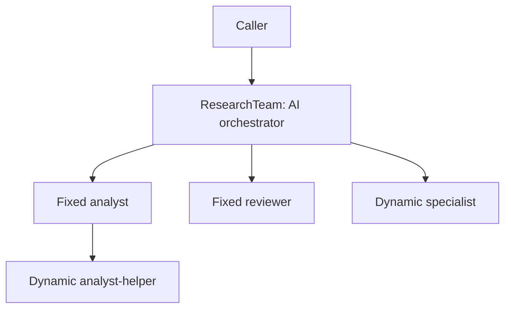

# AI agents and an orchestrated team

Open the [LiveView playground](http://localhost:4000) with `mix phx.server` from
`examples/agent_app`. Every AI role and the orchestrated team have their own
page. Start an offline or live instance, send a prompt, and inspect its topology,
model turns, results, and signal activity. Runs remain available on navigation
and reload; Stop releases the processes.

The command-line demo remains available from `examples/agent_app`:

```sh
mix deps.get
mix ai.demo
mix test
```

`mix ai.demo` runs entirely offline. The scripted model requests real tools;
the runtime executes callbacks, delivers signals, applies actions, and calls
the model again with the results. No provider key or database is needed.

The team resource itself is the top-level AI orchestrator. It starts two fixed
workers, `:analyst` and `:reviewer`. During the demo the orchestrator creates a
`"specialist"`, and the analyst creates its own `"analyst-helper"`. Both levels
use `run_lua` to call the same `agents.spawn` and `agents.delegate` Ash actions.
The analyst owns its helper;
removing the analyst removes that subtree. Team and template limits bound the
number of workers.



## One outside interface

`Aikido.Ash.AI` contributes the same `ask` and `cancel` generic Ash actions to a
single agent and a team. `ai do` supplies defaults, and callers can override
`model`, `client`, `system_prompt`, `max_iterations`, `tools`, and `tool_context`
through ordinary Ash create input. `client` defaults to `ReqLLM.Generation`,
so normal callers only need a model and tools. Custom clients remain optional.
The scripted client is selected explicitly by `AI.offline/1` in demos, tests,
and the playground's offline mode. For example:

```elixir
team = Agents.research_team_start!(%{
  model: runtime_model,
  system_prompt: caller_prompt,
  max_iterations: iteration_limit,
  tools: runtime_tools,
  topology: %{
    "analyst" => %{resource: AgentExamples.Researcher},
    "reviewer" => %{resource: AgentExamples.Reviewer, depends_on: ["analyst"]}
  }
})
```

The optional startup `topology` replaces the declared member graph. Omit it for
DSL defaults, or pass `%{}` for an initially empty team. A nested team node can
supply another graph through `initial_state: %{topology: child_graph}`.

The playground exposes the system prompt and iteration limit in its creation
form. Its mode selector chooses the offline or live client. Fixed and dynamic
workers inherit model/client/tools/iteration settings; their role prompts remain
separate from the orchestrator prompt.

Both resource kinds accept runtime configuration and tools:

```elixir
alias AgentExamples.{Agents, AI}

tools = AI.Tools.for_assistant("my workspace") ++ AI.Tools.from_ash_ai()
team = Agents.research_team_start!(AI.offline(%{tools: tools}))
{:ok, answer} = AI.ask(team, "orchestrate: Signals carry results")

assistant = Agents.assistant_start!(AI.offline(%{tools: AI.Tools.for_assistant("solo")}))
{:ok, answer} = AI.ask(assistant, "Signals carry results")

Agents.research_team_stop!(team)
Agents.assistant_stop!(assistant)
```

`AI.ask/3` is an external caller helper: it subscribes before invoking the
resource's Ash `:ask` action and waits for the correlated final answer. Callers
can also use `Agents.research_team_ask/2` and `Agents.assistant_ask/2` directly
and subscribe to `ai.react.**` for intermediate state. The caller need not know
whether the resource delegates work internally. Tools run in supervised tasks;
they never block a directive executor or write agent state directly.

## Tools are runtime values

The agent DSL does not enumerate its tools. Pass the list in `create` input.
The same resource can have different tools in every instance. Supported entries:

- A `%ReqLLM.Tool{}` created at runtime, with an anonymous callback or MFA.
- A `{%ReqLLM.Tool{}, callback}` pair, where `callback` accepts arguments and
  runtime context. This is the shape used by Ash AI's callback registry.
- An `{AshResource, :generic_action}` pair or a `Aikido.Action` module.

`AI.Tools.for_assistant/1` uses Ash AI to generate both tool schemas and callbacks
from native Ash actions. Its caller-specific label is injected into the Ash
action context; no JSON schema or tool executor is hand-written. Model tool calls resolve only
against the supplied runtime list; nothing scans a global tool registry.

For Ash AI, retain its real execution callbacks:

```elixir
{definitions, registry} = AshAi.build_tools_and_registry(
  otp_app: :agent_examples,
  tools: [:ash_text_stats, :run_lua, :lua_docs]
)

tools = Enum.map(definitions, &{&1, Map.fetch!(registry, &1.name)})
team = Agents.research_team_start!(%{
  model: runtime_model,
  tools: AI.Tools.for_assistant("workspace") ++ tools,
  tool_context: %{actor: current_user, tenant: workspace_id}
})
```

The definition alone contains Ash AI's stub callback. Passing the paired
registry callback executes the actual Ash action, preserving its result and
runtime context. `tool_context` is passed to contextual callbacks, including
Ash AI's actor/tenant handling. Applications remain responsible for choosing
and authorizing that context.

`AgentExamples.AI.LuaSurface` uses `AshLua.EvalActions` to generate `:eval` and
`:docs`. `AgentExamples.Agents` exposes those through Ash AI as `run_lua` and
`lua_docs`. The labelled namespaces expose `analysis.text_stats` and the
team-scoped `agents.spawn`, `agents.members`, `agents.delegate`, `agents.stop`,
and `agents.remove` actions. For analysis the offline model executes:

```lua
return analysis.text_stats({input = {text = 'Lua calls Ash'}})
```

AI agents can request children and delegate work entirely through Lua:

```lua
local roster = assert(agents.members({}))
local worker = assert(agents.spawn({input = {
  name = "helper",
  template = "researcher",
  specialty = "check evidence"
}}))
return assert(agents.delegate({input = {
  member = worker.member,
  text = "Count the words in Signals carry results"
}}))
```

The host supplies the calling agent's runtime context; scripts do not pass IDs
or resource modules. An ordinary worker uses its nearest managing team and is
recorded as owner of its children. A team manages its own members, including
when that team was itself spawned by another team. The `research_team` also
offers a `squad` template for spawning `ResearchSquad`, which can then spawn its
own researchers through exactly the same Lua API. `agents.members` lists the
available templates. Children inherit the caller's model and runtime tools.

`agents.stop` stops an owned subtree but retains its desired topology;
`agents.remove` removes it. Workers manage their own descendants, while a team
orchestrator can manage all its members. Both calls go through the team's
ordinary Ash lifecycle actions. No spawning slice is added to the agents.

This exercises the actual Lua runtime, generated Ash actions, Ash AI callbacks,
and the ReAct loop. AshLua is pinned to the upstream revision used by the
reference application; Ash AI and AshLua are example dependencies, not new
mandatory Aikido dependencies.

## Tools and model configuration during delegation

`team.inherit` copies selected configuration attributes into fixed and dynamic
members. The example copies tools, tool context, model, client, and iteration
limit. Worker prompts remain role-specific. `spawn_worker` explicitly uses the
calling worker's tool list and context, so its subworkers receive the same
runtime capabilities. It records an explicit owner and respects team limits.

With Lua selected, the playground and demos supply Lua management tools rather
than separate spawn/delegate model tools. Direct Ash action tools remain usable
when callers supply them instead. The demo's scripted model deterministically exercises orchestration; it is not
a language model. A live model chooses its own tool calls. Each worker accepts
one active task at a time; busy workers return a correlated task failure.
Delegation is bounded by a timeout and rejects self-delegation. Callers should
break work into bounded subtasks and inspect failures rather than retrying
unboundedly.

## Live z.ai team

Set `ZAI_API_KEY` in your shell without putting it in source files. Then:

```sh
export AIKIDO_AI_MODEL='zai:glm-5.3'
mix ai.live
```

Use a model enabled on your account. `zai:<model-id>` selects the standard
endpoint; `zai_coder:<model-id>` selects ReqLLM's coding endpoint. See the
[official z.ai quick start](https://docs.z.ai/guides/overview/quick-start) for
API access and its Coding Plan endpoint instructions.

The live entry point creates the same team with the default `ReqLLM.Generation`
client and a runtime model specification, then asks for worker-created helpers and
independent review. The key stays in ReqLLM's environment lookup. This path
requires a real account and is not part of the offline tests.
